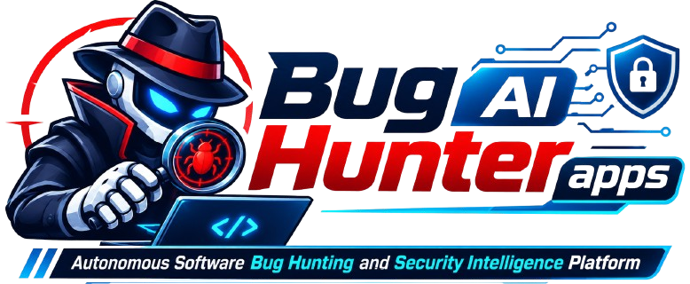

# BUG HUNTER AI

**Autonomous Software Intelligence Platform**



BUG HUNTER AI is an AI-powered software quality and security intelligence platform designed to help engineering teams discover, investigate, reproduce, and resolve software defects.

## Project Vision

Build a unified bug-hunting platform for web applications, mobile applications, and APIs, with AI-assisted analysis, security testing, root-cause investigation, regression validation, and controlled repair workflows.

## Current Implementation Status

| Component | Current status |
|---|---|
| Web dashboard | Next.js application implemented; API integration added |
| Backend API | NestJS health and dashboard endpoints available |
| Database | Not configured |
| Redis / job queue | Not configured |
| AI engine | Not connected |
| Automated scanners | Not yet integrated |
| Autonomous repair | Planned; not operational |

**Important:** A successful API response means the API is reachable. It does not mean the database, AI engine, or scanning infrastructure is connected.

## Architecture

```text
BUG-HUNTER-AI/
├── apps/
│   ├── api/                 # NestJS backend
│   ├── desktop/             # Tauri desktop application
│   └── web/                 # Next.js dashboard
├── config/
├── docs/
├── infrastructure/
├── packages/
├── scripts/
├── services/
├── storage/
├── tests/
└── workers/
```

## Technology Stack

- Web: Next.js, React, TypeScript
- Backend: NestJS, Node.js
- Desktop target: Tauri 2, React, TypeScript
- AI services target: Python, FastAPI
- Data layer target: PostgreSQL, pgvector
- Queue target: Redis and BullMQ
- Security and observability target: isolated execution, audit logging, OpenTelemetry

## Development Environment

Requirements:
- Node.js
- npm
- Git

### Start the API

Open PowerShell:

```powershell
cd D:\BUG-HUNTER-AI\apps\api
npm install
$env:PORT = "4100"
$env:CORS_ORIGINS = "http://localhost:3002"
npm run start:dev
```

API endpoints:
- Health: `http://localhost:4100/api/v1/health`
- Dashboard overview: `http://localhost:4100/api/v1/dashboard/overview`
- Swagger documentation: `http://localhost:4100/api/docs`

### Start the Web Dashboard

Open another PowerShell window:

```powershell
cd D:\BUG-HUNTER-AI\apps\web
npm install
npm run dev -- --port 3002
```

Open `http://localhost:3002` in your browser.

## Configuration

Use `apps/api/.env.example` as the reference for API environment configuration. Do not commit real credentials, API keys, tokens, or production secrets.

## Security Principles

- Authorized testing only.
- Isolated execution environments for scanning workloads.
- Read-only source inspection by default.
- No direct production modifications.
- Human approval for destructive changes, database changes, and deployments.
- Secret redaction and auditable operations.
- Tenant isolation and least-privilege access.
- Network egress restrictions and resource limits for scanner workloads.

## Documentation

- [FEATURE.md](FEATURE.md) - Product capabilities, requirements, and roadmap.

## Project Status

BUG HUNTER AI is under active development. The current repository contains the initial project structure, a web dashboard, and a basic API. Advanced scanning, AI analysis, persistent storage, and repair capabilities remain under development.

## License

License has not yet been specified.
